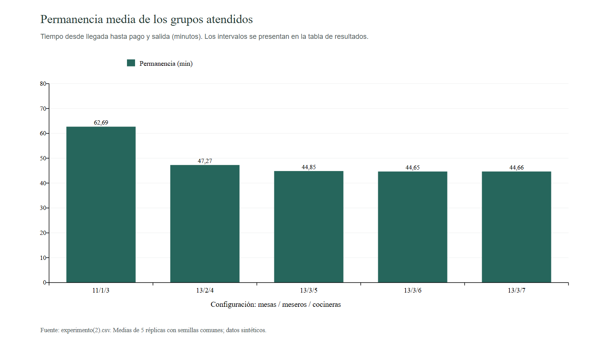
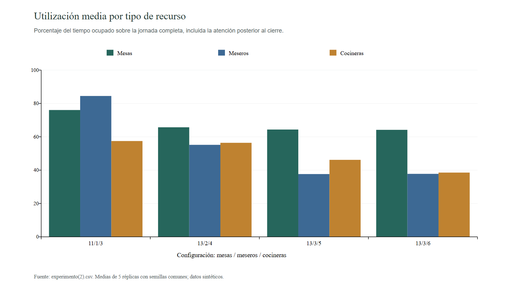
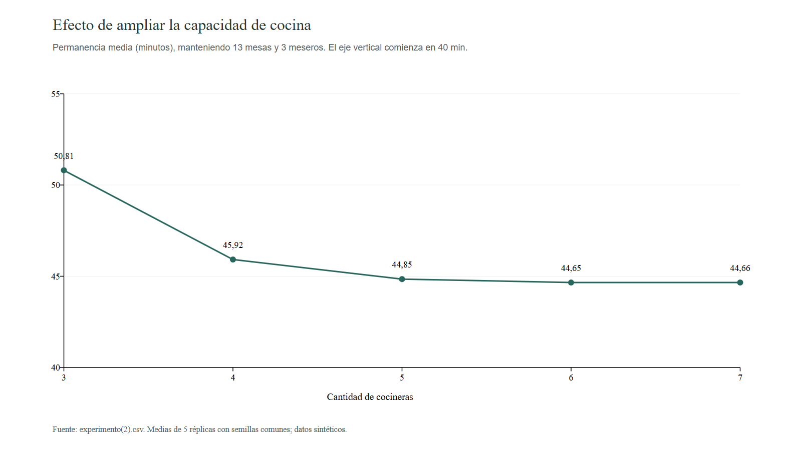

# Texto propuesto para las secciones 6.4 a 10 del informe

**Base documental:** `InformeFinalSimulacion.md`, `experimento.csv`, `experimento(1).csv` y `experimento(2).csv`. Los resultados se contrastaron con sus registros JSON en `datos/experimentos/`. Se mantienen los números de las referencias bibliográficas de la introducción.

## Notas para integrar este contenido

Estas notas orientan la edición y pueden retirarse de la versión final del informe:

- Los experimentos entregados utilizaron **20 grupos/hora en horas pico y paciencia uniforme entre 0 y 20 minutos**. Los valores 25 grupos/hora y 40 minutos del borrador describen otra parametrización. Para que el informe corresponda a estos resultados, deben actualizarse también las secciones previas y la tabla de parámetros.
- Los tiempos realmente utilizados fueron pedido U(2,4), preparación triangular(8,12,20), entrega U(1,2), consumo triangular(10,20,40) y cobro U(1,3), todos en minutos. Por tanto, no corresponden a los tiempos de referencia de 2 minutos, 7 minutos y entrega máxima de 1 minuto que aparecen en el borrador.
- Los tres archivos contienen **282 filas, pero 183 combinaciones distintas**. `experimento(1).csv` está contenido en `experimento(2).csv`; los resultados compartidos coinciden. Los tres lotes reutilizan semillas. Sus filas y réplicas no deben presentarse como evidencia independiente acumulada.
- Los CSV y sus JSON corresponden al **modelo 1.0.0** y no incluyen longitudes promedio de cola ni contrastes de Little. La versión actual del programa, 1.1.0, sí incorpora esos cálculos. El texto distingue esta mejora del instrumento de los resultados históricos disponibles.
- La etiqueta `eficiente` utiliza un criterio de Pareto sobre cantidades de recursos, abandono y espera por mesa. No significa que el escenario minimice la permanencia ni que sea el más económico. Tampoco se encontraron umbrales de servicio previamente aprobados que permitan declarar una única configuración ideal.
- Al revisar la introducción, conviene precisar que el resumen del trabajo de Buzali et al. [8] describe una reducción del 40 % en **espera**; ese porcentaje no debe trasladarse automáticamente al tiempo total de permanencia.

---

## 6.4. Procedimiento

El trabajo se desarrolló mediante las diez etapas que se describen a continuación. Se diferenciaron la construcción del instrumento computacional y el análisis de los experimentos archivados, con el fin de conservar la correspondencia entre parámetros, versiones y resultados.

### Etapa 1. Identificación y análisis del problema

Se identificó como problema la asignación de capacidad entre mesas, meseros y cocineras durante una jornada con demanda variable. Se representó el servicio como una secuencia de llegada del grupo, espera por mesa, toma del pedido, preparación, entrega, consumo, cobro y salida. Las mesas se consideraron ocupadas hasta finalizar el pago, mientras que el personal se liberó al concluir cada actividad.

Se estableció una configuración de comparación de 11 mesas de cuatro puestos, un mesero y tres cocineras. El alcance se limitó a cantidades y disponibilidad de recursos. No se representaron distancias, distribución arquitectónica ni costos. Esta delimitación permitió estudiar si una ampliación localizada reducía la congestión general o la trasladaba hacia otra etapa.

### Etapa 2. Revisión de literatura científica

Se revisaron las investigaciones ya incluidas en la introducción. Dey et al. [2] aportaron una referencia sobre redes de colas y dimensionamiento de servidores. Kimes y Thompson [4] mostraron la utilidad de evaluar configuraciones de mesas mediante simulación. Los trabajos de Buzali et al. [8] y Samad et al. [9] orientaron la comparación de capacidad, esperas y utilización. Herrera-Barbas et al. [10] proporcionaron un antecedente de análisis de servicio mediante simulación de eventos discretos. Finalmente, Sargent [3] permitió diferenciar la verificación del programa y la validación de su representación del sistema real.

La revisión se utilizó para seleccionar indicadores y criterios de interpretación. Los porcentajes de mejora de otros establecimientos no se adoptaron como metas del presente experimento, debido a sus diferencias de demanda, recursos y definición de indicadores.

### Etapa 3. Selección de los modelos y métodos

Se seleccionó una red de colas implementada mediante simulación de eventos discretos en Python y SimPy. Los grupos de clientes constituyeron las entidades; las mesas, meseros y cocineras se representaron como recursos de capacidad limitada. La asignación de mesas fue compatible y no estrictamente FIFO: un grupo posterior pudo ser atendido cuando existía capacidad suficiente, aunque otro grupo continuara esperando.

Los grupos de cinco a ocho personas adquirieron dos mesas simultáneamente, conservando un único pedido grupal. Los meseros compartieron las tareas de pedido, entrega y cobro. La cocina atendió pedidos grupales conforme se liberaron sus recursos. Se incorporó abandono únicamente durante la espera por mesa.

Para explorar las cantidades de recursos se empleó enumeración exhaustiva o fuerza bruta sobre rejillas finitas. Las expresiones M/M/s se mantuvieron como referencias teóricas; los resultados presentados se obtuvieron del motor de eventos y no de aplicar directamente fórmulas estacionarias de ese modelo.

### Etapa 4. Definición de variables y parámetros

Las variables de decisión fueron las cantidades de mesas M, meseros S y cocineras C. Las entradas aleatorias fueron los intervalos entre llegadas, el tamaño del grupo, la paciencia y las duraciones de las actividades. Las salidas comprendieron atención completada, abandono, esperas, permanencia y utilización.

**Tabla 1. Parámetros efectivos de los tres experimentos analizados.**

| Parámetro | Valor utilizado |
|---|---|
| Jornada de admisión | 09:00 a 20:00 |
| Llegadas normales | 8 grupos/hora |
| Llegadas en horas pico | 20 grupos/hora |
| Horas pico | 12:00–14:00 y 18:00–20:00 |
| Capacidad de cada mesa | 4 personas |
| Tamaños de grupo | 1 a 8 personas |
| Probabilidades para tamaños 1 a 8 | 30 %, 30 %, 18 %, 10 %, 6 %, 3 %, 2 % y 1 % |
| Pedido | Uniforme entre 2 y 4 minutos |
| Preparación por pedido grupal | Triangular: mínimo 8, moda 12 y máximo 20 minutos |
| Entrega | Uniforme entre 1 y 2 minutos |
| Consumo | Triangular: mínimo 10, moda 20 y máximo 40 minutos |
| Cobro | Uniforme entre 1 y 3 minutos |
| Paciencia para obtener mesa | Uniforme entre 0 y 20 minutos |
| Cierre | Se detuvieron las llegadas y se completó el desenlace de los grupos admitidos |
| Naturaleza de los datos | Sintéticos, sin calibración empírica |

Fuente: solicitudes de ejecución conservadas en los JSON que respaldan los tres CSV. Estos parámetros se mantuvieron constantes entre escenarios; las variaciones experimentales se aplicaron a M, S y C.

Con siete horas de demanda normal y cuatro de demanda pico, el número esperado de llegadas fue de 7 × 8 + 4 × 20 = 136 grupos por jornada. Este valor esperado se distinguió de los conteos aleatorios obtenidos en cada réplica.

### Etapa 5. Formulación de los modelos matemáticos

Las llegadas se representaron mediante un proceso de Poisson por tramos, con tasa λ(t)=20 grupos/hora durante los dos intervalos pico y λ(t)=8 en los demás periodos de admisión. En cada franja se generaron intervalos exponenciales con media 60/λ(t), en minutos. Esta conversión evitó mezclar tasas horarias con tiempos de actividad expresados en minutos.

La utilización se definió como el tiempo ocupado acumulado dividido entre la capacidad disponible durante la observación. Las esperas se obtuvieron por diferencia entre solicitud y adquisición del recurso. La permanencia de cada grupo atendido se calculó como salida menos llegada. El abandono correspondió a la proporción de grupos que agotaron su paciencia antes de obtener mesa.

Para completar la formulación del instrumento se incorporó en la versión 1.1.0 la longitud promedio de cada cola mediante integración temporal de sus eventos. También se incorporó el contraste de Little [1], manteniendo iguales población, ventana y unidades en ambos lados de la relación. Estos cálculos no se atribuyeron retrospectivamente a los CSV de la versión 1.0.0, que no los contienen.

### Etapa 6. Implementación computacional

Se implementó un sistema modular con contratos de configuración, motor SimPy, análisis de resultados, persistencia y API. La interfaz permitió modificar parámetros, ejecutar escenarios, reproducir eventos y consultar indicadores. La lógica de simulación permaneció en Python y separada de su presentación visual.

El motor registró las llegadas, asignaciones, actividades, abandonos y salidas. Se verificaron la exclusión de mesas, la adquisición simultánea de dos mesas por grupos grandes, la capacidad del personal y la liberación de mesas después del cobro. Cada ejecución conservó configuración y semilla, lo que permitió rastrear sus resultados. Los tres lotes históricos analizados identifican la versión 1.0.0 del modelo.

### Etapa 7. Ejecución de los experimentos

Se analizaron tres lotes, denominados E1, E2 y E3 según el archivo de procedencia. Cada combinación de recursos se ejecutó mediante réplicas con semillas independientes entre sí, reutilizadas entre escenarios para conservar condiciones equivalentes de demanda.

**Tabla 2. Diseño de los experimentos por fuerza bruta.**

| Lote y archivo | Mesas evaluadas | Meseros | Cocineras | Combinaciones | Réplicas por combinación | Corridas contabilizadas |
|---|---|---|---|---:|---:|---:|
| E1: `experimento.csv` | 9, 11 y 13 | 1 a 7 | 1 a 7 | 147 | 4 | 588 |
| E2: `experimento(1).csv` | 9 a 13, paso 1 | 1 a 3 | 2 a 4 | 45 | 5 | 225 |
| E3: `experimento(2).csv` | 9 a 13, paso 1 | 1 a 3 | 2 a 7 | 90 | 5 | 450 |

En E1 se solicitó un rango de mesas entre 9 y 14 con paso 2, que generó únicamente 9, 11 y 13 mesas. La configuración de 14 mesas no fue evaluada. El total de los archivos fue de 282 filas y 1263 corridas contabilizadas por lote, correspondientes a 183 combinaciones distintas. Estas cantidades no representan observaciones independientes acumulables, porque E2 está incluido en E3 y existen escenarios y semillas compartidos con E1.

La semilla principal fue 42. Las semillas de réplica fueron 2684470948, 4091952314, 233227757 y 3276785861 en E1. E2 y E3 utilizaron esas cuatro y una quinta, 3644269654. Para la comparación detallada se empleó E3, que reúne cinco réplicas y el mayor intervalo de cocineras dentro de la rejilla de uno a tres meseros.

### Etapa 8. Recolección de resultados

Se recopilaron las medias y los límites de confianza de los indicadores exportados en los CSV. Se identificó el JSON de respaldo de cada archivo y se comprobó la correspondencia de sus 66 columnas con los resúmenes almacenados. Asimismo, se revisó por réplica que los grupos llegados fueran iguales a atendidos más abandonados, y que se cumpliera el mismo balance para las personas.

Se conservaron separados los lotes de cuatro y cinco réplicas. Los 45 escenarios compartidos por E2 y E3 presentaron las mismas métricas. Para los 54 escenarios comunes entre E1 y E3, las primeras cuatro réplicas también coincidieron. Por ello, las exportaciones compartidas no se trataron como nuevas confirmaciones independientes.

### Etapa 9. Representación gráfica de los datos

Los resultados se organizaron en tablas comparativas y tres gráficos: permanencia media de configuraciones seleccionadas, variación de la permanencia al aumentar cocineras y utilización por tipo de recurso. Se identificaron en cada figura el lote, número de réplicas, unidades y configuración M/S/C.

Los gráficos se elaboraron a partir de las medias de E3. Los intervalos de confianza se presentaron en tablas para diferenciar el comportamiento observado de su incertidumbre. La representación permitió examinar simultáneamente el efecto de la capacidad adicional y el grado de ocupación de los recursos.

### Etapa 10. Comparación y análisis de los resultados

Se comparó la configuración 11/1/3 con alternativas que modificaron únicamente mesas, únicamente meseros o varios recursos. Se identificó el menor tiempo de permanencia observado en cada lote y se examinó por separado la etiqueta de eficiencia de Pareto generada por el programa.

Para algunas comparaciones de E3 se calcularon diferencias pareadas entre las cinco réplicas archivadas. Este procesamiento posterior permitió evaluar cambios respecto de la referencia usando las mismas semillas. No se ejecutaron nuevas simulaciones para producir las tablas y figuras de este análisis. Los resultados se interpretaron dentro de la rejilla y de los supuestos sintéticos considerados.

## 6.5. Evaluación

La evaluación se vinculó con los dos objetivos específicos. Para el primero se comprobó la representación de las reglas operativas y la coherencia del instrumento. Para el segundo se compararon los indicadores de los escenarios y la dotación requerida para obtenerlos.

### 6.5.1. Criterios asociados con el objetivo específico 1

Se revisaron la secuencia de servicio, el respeto de las capacidades, la exclusión de mesas y personal, la adquisición atómica de dos mesas, la cancelación de solicitudes por abandono y el cierre de llegadas a las 20:00. También se consideró la conservación de parámetros y semillas para reproducir ejecuciones.

Se distinguió la verificación computacional de la validación empírica conforme a Sargent [3]. Las pruebas de reglas e identidades permiten revisar la coherencia del programa. Como las entradas fueron sintéticas y no se contrastaron con observaciones de un establecimiento, no se afirmó validación empírica del restaurante.

### 6.5.2. Métricas asociadas con el objetivo específico 2

**Tabla 3. Indicadores, unidades y criterio de interpretación.**

| Indicador | Definición utilizada | Unidad y criterio |
|---|---|---|
| Permanencia media de atendidos | Promedio de salida menos llegada entre los grupos que completan el servicio | Minutos; menor es favorable, interpretándolo junto con atención y abandono |
| Espera media por mesa | Espera hasta asignación o abandono, promediada sobre todos los grupos llegados | Minutos; menor es favorable, pero no equivale a la permanencia |
| Esperas por actividad | Promedio del tiempo hasta recibir pedido, preparación, entrega o cobro entre atendidos | Minutos; permiten localizar la congestión |
| Abandono | 100 × grupos abandonados / grupos llegados, calculado por réplica y luego promediado | Porcentaje; menor es favorable |
| Atención completada | Grupos y personas que finalizan el pago | Grupos/jornada y personas/jornada; mayor es favorable bajo la misma demanda |
| Utilización | 100 × tiempo ocupado acumulado / capacidad-tiempo disponible | Porcentaje; se interpreta con las esperas, sin asumir que el máximo sea lo deseable |
| Dotación | Cantidades M, S y C evaluadas | Recursos por tipo; una ampliación debe relacionarse con la mejora conseguida |
| Longitud media de cola | Área temporal de Q(t) dividida entre T | Grupos; implementada en la versión actual, sin resultados exportados en los tres CSV históricos |

El periodo de observación comprendió desde la apertura hasta finalizar los grupos admitidos. Por ello, la utilización incluyó la atención posterior al cierre. Los valores fraccionarios de personas o grupos en las tablas representan medias entre jornadas simuladas, no entidades fraccionadas en una ejecución.

La permanencia se calculó solamente entre atendidos, mientras que la espera por mesa incluyó abandonos. Estas poblaciones se mantuvieron diferenciadas. Tampoco se reemplazó la media de tasas de abandono por el cociente de los conteos medios, porque ambas operaciones pueden producir resultados distintos.

### 6.5.3. Incertidumbre y comparación de escenarios

Para cada indicador se utilizó la media entre réplicas y un intervalo t de Student bilateral del 95 %:

\[
\bar{x}\pm t_{0,975;n-1}\frac{s}{\sqrt{n}}.
\]

En las comparaciones pareadas se calculó, para cada semilla, la diferencia entre la alternativa y la referencia. Posteriormente se estimó su media e intervalo mediante la misma expresión. Una diferencia negativa de permanencia representó una reducción. Los intervalos de diferencias se interpretaron como exploratorios: se utilizaron pocas réplicas y no se aplicó ajuste por haber examinado numerosas configuraciones.

El mínimo observado entre muchas alternativas puede estar favorecido por variabilidad muestral. Por tanto, no se consideró suficiente una diferencia pequeña entre medias para afirmar una ventaja generalizable ni se utilizaron los resultados compartidos entre archivos como réplicas adicionales.

### 6.5.4. Eficiencia y criterio de selección

El criterio de Pareto aplicado por el programa minimizó simultáneamente cinco componentes:

\[
(M,\ S,\ C,\ \bar P_{aband},\ \bar W_{mesa}).
\]

Una configuración se consideró dominada cuando otra no empeoró ninguno de esos componentes y mejoró al menos uno. La permanencia media se examinó adicionalmente para responder al interés del informe por reducir el tiempo total, pero no forma parte de la etiqueta `eficiente` de estos archivos.

Se distinguieron, en consecuencia, el escenario de menor permanencia observada y las alternativas eficientes por dotación, abandono y espera. No se definió una suma monetaria de recursos ni una ponderación arbitraria entre tipos de personal. Al no disponer de costos ni de límites de servicio aprobados, no se declaró una única configuración económicamente óptima o universalmente ideal.

## 7. Resultados

Los resultados se presentan según los dos objetivos específicos. La notación M/S/C indica mesas, meseros y cocineras. Excepto donde se identifica otro lote, las comparaciones numéricas corresponden a E3 y sus cinco réplicas.

### 7.1. Resultados del objetivo específico 1

**Objetivo:** implementar un modelo computacional de red de colas en Python que represente las etapas del servicio del restaurante e integre llegadas, tiempos y capacidades.

Se obtuvo un simulador modular que representó el recorrido completo de los grupos, la ocupación de mesas hasta el pago y la competencia por personal compartido. El modelo permitió variar las cantidades de mesas, meseros y cocineras mediante configuraciones, sin modificar sus procesos de servicio.

**Tabla 4. Productos obtenidos para el primer objetivo.**

| Componente | Resultado verificable |
|---|---|
| Contratos y configuración | Parámetros tipados, distribuciones configurables y validación centralizada |
| Motor de eventos discretos | Llegadas por franja, formación de grupos, asignación compatible, abandono y servicio completo |
| Gestión de recursos | Dos mesas adquiridas conjuntamente para grupos grandes; meseros compartidos; cocina por pedido grupal |
| Registro experimental | Configuración, versión, semilla y métricas por réplica conservadas en archivos |
| Instrumento de análisis | Resúmenes estadísticos, comparación de escenarios y clasificación de Pareto |
| Interfaz | Edición de escenarios, reproducción de eventos, gráficos y exportación |
| Ampliación posterior 1.1.0 | Integración temporal de cinco colas y contraste de Little con poblaciones compatibles |

Los JSON permitieron identificar inequívocamente el respaldo de los tres CSV y comprobar los balances de grupos y personas en sus réplicas. Esta trazabilidad constituyó un resultado del instrumento y permitió separar diferencias de parametrización, cantidad de réplicas y capacidad.

Los experimentos históricos correspondieron a la versión 1.0.0. Sus archivos no contienen valores numéricos de longitud media de cola ni contrastes de Little. La implementación actual incorpora estas funciones, pero el presente análisis no presenta valores históricos que no fueron exportados ni sustituye esos faltantes por una simulación distinta. Para completar la evaluación experimental de esas dos dimensiones se requiere repetir o ampliar las exportaciones con la versión que las registra.

### 7.2. Resultados del objetivo específico 2

**Objetivo:** evaluar combinaciones de recursos mediante simulación y métricas de rendimiento para identificar alternativas eficientes dentro de las condiciones estudiadas.

#### 7.2.1. Cobertura de la búsqueda

Los lotes produjeron 147, 45 y 90 escenarios, respectivamente. Tras identificar los solapamientos, se contabilizaron 183 combinaciones distintas. La clasificación incluida en los archivos identificó 75 alternativas no dominadas en E1, 45 en E2 y 71 en E3, siempre respecto del conjunto y los cinco objetivos de cada lote.

**Tabla 5. Menor permanencia observada en cada lote.**

| Lote | Configuración M/S/C | Permanencia media de atendidos (min) | Interpretación |
|---|---|---:|---|
| E1, cuatro réplicas | 13/6/7 y 13/7/7 | 44,43 | Empate en la media mínima; ambas figuran como dominadas bajo el criterio de Pareto del programa |
| E2, cinco réplicas | 10/3/4 | 45,65 | Menor permanencia de su rejilla; no es el escenario de menor abandono de E2 |
| E3, cinco réplicas | 13/3/6 | 44,65 | Menor permanencia de E3 y alternativa no dominada en ese lote |

E1 registró 140,50 grupos y 361,50 personas llegadas por jornada como medias de cuatro réplicas. E2 y E3 registraron 135,60 grupos y 347,80 personas como medias de cinco. La diferencia se explica por la incorporación de la quinta semilla; las cuatro primeras realizaciones compartidas fueron idénticas. Estos mínimos no se compararon como si procedieran de tres muestras independientes con el mismo tamaño.

#### 7.2.2. Comparación con la configuración de referencia

**Tabla 6. Desempeño de configuraciones seleccionadas de E3.**

| M/S/C | Permanencia (min) | Espera por mesa, todos los grupos (min) | Abandono (%) | Grupos atendidos/jornada | Personas atendidas/jornada |
|---|---:|---:|---:|---:|---:|
| 11/1/3 | 62,69 | 4,27 | 31,45 | 92,60 | 225,40 |
| 13/1/3 | 68,57 | 3,80 | 28,87 | 96,20 | 236,40 |
| 11/2/3 | 49,14 | 2,90 | 19,73 | 108,60 | 270,40 |
| 11/3/3 | 48,19 | 2,77 | 19,14 | 109,40 | 272,60 |
| 13/2/4 | 47,27 | 1,96 | 11,63 | 119,60 | 297,40 |
| 13/3/4 | 45,92 | 1,77 | 10,62 | 121,00 | 302,60 |
| 13/3/5 | 44,85 | 1,62 | 9,72 | 122,20 | 307,20 |
| 13/3/6 | 44,65 | 1,58 | 9,56 | 122,40 | 308,20 |
| 13/3/7 | 44,66 | 1,60 | 9,43 | 122,60 | 308,00 |

Fuente: `experimento(2).csv`. Todos los valores son medias de cinco réplicas. Las configuraciones seleccionadas de esta tabla figuran como eficientes según el criterio del programa.

La ampliación exclusiva de mesas, de 11/1/3 a 13/1/3, redujo el abandono en 2,58 puntos porcentuales y elevó la atención en 11 personas por jornada, pero incrementó la permanencia media en 5,88 minutos. En cambio, incorporar un segundo mesero manteniendo 11 mesas y tres cocineras redujo la permanencia en 13,55 minutos y elevó la atención en 45 personas por jornada.

Frente a 11/1/3, la alternativa 13/3/6 redujo la permanencia media en 18,03 minutos, equivalentes al 28,77 %. La espera media por mesa disminuyó un 62,95 % y el abandono pasó de 31,45 % a 9,56 %, una disminución de 21,89 puntos porcentuales. Las personas atendidas aumentaron de 225,40 a 308,20 por jornada, un 36,73 %.

**Figura 1.** Permanencia media de los grupos atendidos en configuraciones seleccionadas. Fuente: elaboración a partir de E3; cinco réplicas por escenario. Los intervalos individuales se presentan en la tabla siguiente.

**Tabla 7. Permanencia e intervalos t del 95 % de E3.**

| M/S/C | Media (min) | IC 95 % de la media (min) |
|---|---:|---|
| 11/1/3 | 62,69 | [60,65; 64,73] |
| 11/2/3 | 49,14 | [48,15; 50,13] |
| 13/2/4 | 47,27 | [46,15; 48,39] |
| 13/3/5 | 44,85 | [43,92; 45,77] |
| 13/3/6 | 44,65 | [43,64; 45,67] |
| 13/3/7 | 44,66 | [43,55; 45,76] |

#### 7.2.3. Utilización y localización de las esperas

**Tabla 8. Utilización media de recursos en E3.**

| M/S/C | Mesas (%) | Meseros (%) | Cocineras (%) |
|---|---:|---:|---:|
| 11/1/3 | 76,05 | 84,48 | 57,46 |
| 11/2/3 | 71,52 | 49,74 | 67,83 |
| 13/2/4 | 65,69 | 55,17 | 56,39 |
| 13/3/5 | 64,35 | 37,64 | 46,17 |
| 13/3/6 | 64,16 | 37,77 | 38,53 |

El recurso mesero registró la mayor utilización de la referencia. Al pasar a dos meseros, la utilización media de ese personal descendió de 84,48 % a 49,74 %, mientras que la de cocina aumentó de 57,46 % a 67,83 %. El mayor número de grupos atendidos incrementó, por tanto, la carga que alcanzó la cocina.

**Tabla 9. Esperas medias por actividad entre grupos atendidos en E3.**

| M/S/C | Mesa (min) | Pedido (min) | Preparación (min) | Entrega (min) | Cobro (min) |
|---|---:|---:|---:|---:|---:|
| 11/1/3 | 2,94 | 5,30 | 0,40 | 5,80 | 5,04 |
| 11/2/3 | 2,07 | 0,41 | 2,72 | 0,39 | 0,40 |
| 13/3/6 | 1,17 | 0,10 | 0,07 | 0,10 | 0,09 |

En esta tabla la espera por mesa corresponde únicamente a atendidos, a diferencia de la tabla 6. La preparación expresa espera antes de acceder a cocina, no duración de preparación. Estas distinciones evitan sumar indicadores de poblaciones diferentes o confundir cola con servicio.

**Figura 2.** Utilización media por tipo de recurso durante la jornada completa de E3. Una menor utilización después de ampliar la dotación no representa por sí misma un peor desempeño.

#### 7.2.4. Rendimientos marginales y comparación pareada

Con 13 mesas y tres meseros, aumentar cocina de tres a cuatro recursos redujo la permanencia de 50,81 a 45,92 minutos. La reducción de cinco a seis cocineras fue de 0,191 minutos, aproximadamente 11,48 segundos. De seis a siete, la media pasó de 44,654 a 44,659 minutos, sin una mejora observada de permanencia.

**Figura 3.** Permanencia media para 13 mesas y tres meseros, variando cocina en E3. El eje vertical comienza en 40 minutos para mostrar el comportamiento marginal.

**Tabla 10. Diferencias pareadas de permanencia en E3.**

| Cambio evaluado | Diferencia media: alternativa − referencia (min) | IC 95 % de la diferencia (min) |
|---|---:|---|
| 11/1/3 a 13/1/3 | +5,880 | [3,172; 8,588] |
| 11/1/3 a 11/2/3 | −13,545 | [−15,298; −11,793] |
| 11/1/3 a 13/3/6 | −18,032 | [−19,867; −16,198] |
| 13/3/5 a 13/3/6 | −0,191 | [−0,354; −0,029] |
| 13/3/6 a 13/3/7 | +0,005 | [−0,155; 0,165] |

Fuente: cálculo posterior sobre las cinco réplicas archivadas de E3, emparejadas por semilla. Son intervalos nominales, exploratorios y sin ajuste por selección entre múltiples escenarios.

La comparación de cinco a seis cocineras produjo un intervalo de permanencia enteramente negativo, aunque la magnitud de la reducción fue pequeña. Para ese mismo cambio, el incremento de personas atendidas fue de una persona por jornada, con IC 95 % [−1,15; 3,15]. El cambio de seis a siete no permitió establecer una reducción de permanencia a partir de estas réplicas. Se evidenció así la necesidad de diferenciar una variación estadística de su importancia operativa.

En E3, 13/3/6 constituye la candidata si se prioriza la menor permanencia media observada. La configuración 13/3/5 ofrece una media cercana con una cocinera menos. La alternativa 13/2/4 utiliza un mesero y dos cocineras menos que 13/3/6, con una permanencia 2,62 minutos mayor. Elegir entre ellas exige precisar prioridades de servicio y restricciones de dotación que no se encuentran cuantificadas en los datos entregados.

## 8. Discusión

### 8.1. Interdependencia de la capacidad

El incremento de mesas redujo los rechazos por espera, pero empeoró la permanencia cuando se mantuvo un solo mesero. Este resultado muestra que admitir más grupos puede aumentar la carga de las actividades compartidas. La red de servicio debe analizarse de manera conjunta, en consonancia con Dey et al. [2], quienes estudiaron el dimensionamiento de estaciones de una red de colas. La diferencia es que dicho antecedente incorporó costos y modelos analíticos, mientras que este trabajo utilizó eventos discretos, abandono y datos sintéticos. La implicación operativa es que una ampliación de mesas requiere revisar también la capacidad de atención y preparación.

### 8.2. Disponibilidad de mesas y grupos atendidos

Las configuraciones de mayor capacidad de mesas permitieron atender más personas cuando se acompañaron de personal suficiente. Este comportamiento es coherente con la importancia que Kimes y Thompson [4] atribuyen a la capacidad y composición de mesas. Sin embargo, su estudio examinó una mezcla de tamaños y datos de un restaurante real, mientras que aquí todas las mesas tuvieron cuatro puestos y los grupos grandes adquirieron dos. Por ello, no corresponde equiparar porcentajes de mejora ni inferir aumentos de ingresos. El aporte del presente modelo es mostrar la relación entre disponibilidad de mesas, retención de grupos y carga del personal bajo esas reglas concretas.

### 8.3. Meseros como recurso compartido

La referencia presentó esperas elevadas para pedido, entrega y cobro, junto con una utilización del mesero de 84,48 %. Añadir un segundo mesero redujo esas esperas y elevó la carga de cocina. Buzali et al. [8] también identificaron la necesidad de localizar el punto de congestión antes de modificar la dotación de servicio y preparación. La coincidencia es metodológica: en ambos casos se evalúa qué recurso limita el flujo. Las actividades y entidades de una cafetería difieren de las de este restaurante, por lo que no se trasladan sus cantidades óptimas ni sus porcentajes al presente caso. La implicación es priorizar cambios en el recurso que acumula demoras y comprobar su efecto sobre las estaciones siguientes.

### 8.4. Rendimientos decrecientes al ampliar cocina

La reducción de permanencia se hizo menor al pasar de cinco a seis cocineras y no mejoró al incorporar una séptima. También disminuyó la utilización media de cocina, de 46,17 % en 13/3/5 a 38,53 % en 13/3/6. Esta evidencia indica que aumentar capacidad puede dejar disponibilidad sin aprovechar una vez que otras actividades, el consumo y la admisión condicionan el tiempo total. La selección no puede basarse exclusivamente en incrementar servidores. Tampoco permite afirmar que seis cocineras sean económicamente convenientes: la mejora marginal de 11,48 segundos debe valorarse frente a restricciones de dotación o costos que no fueron incluidos.

### 8.5. Comparación de indicadores con investigaciones anteriores

Samad et al. [9] analizaron conjuntamente esperas y utilización para identificar desequilibrios en un restaurante. En este trabajo se observó que una utilización elevada del personal de sala coexistió con demoras en varias actividades, y que su ampliación redistribuyó la carga hacia cocina. Esta coincidencia respalda la lectura conjunta de indicadores. Las magnitudes absolutas de espera no se consideran directamente comparables, porque cambian las actividades, las poblaciones observadas y la duración de los estudios. En particular, la espera por mesa de este modelo no equivale a la espera total o por servidor de otras investigaciones.

### 8.6. Alcance de la evidencia y aporte del modelo

Herrera-Barbas et al. [10] apoyaron su modelo en observaciones de llegadas y servicio. El presente trabajo se diferencia por utilizar parámetros sintéticos, lo que facilita experimentar de forma controlada, pero limita la transferencia de las cantidades encontradas a un establecimiento real. Conforme a Sargent [3], comprobar el programa y sus balances es distinto de demostrar exactitud para una aplicación concreta. Por tanto, la evidencia respalda el funcionamiento del instrumento y las comparaciones internas realizadas, mientras que la aplicación operativa requiere medición y calibración.

La ampliación matemática del programa permite registrar colas y contrastar Little [1] en una jornada con cohortes completas. No obstante, esa mejora no sustituye las métricas ausentes de los archivos históricos. Además, la coincidencia de Little representa una comprobación de balance de población y tiempos, y no demuestra por sí sola un régimen estacionario ni las condiciones M/M/s.

El aporte del trabajo es una implementación reproducible que integra mesas adquiridas conjuntamente, abandono y personal compartido, junto con una búsqueda exhaustiva verificable de recursos. El análisis de las exportaciones añade trazabilidad al reconocer escenarios repetidos y semillas compartidas, evitando presentar archivos solapados como evidencia independiente.

### 8.7. Límites de la selección de una configuración ideal

Las diferencias entre el mínimo de permanencia y la etiqueta de Pareto se explican porque optimizan criterios diferentes. En E1, las configuraciones 13/6/7 y 13/7/7 alcanzaron la menor permanencia, pero fueron dominadas respecto de dotación, abandono y espera por mesa. El software no incluyó la permanencia en esa etiqueta. Por tanto, no existe contradicción numérica: existe una diferencia de función objetivo que debe quedar explícita.

El número reducido de réplicas, la selección entre muchas alternativas y la falta de umbrales aprobados limitan una elección definitiva. E2 no constituye una validación independiente de E3 y sus resultados no deben duplicarse para aumentar artificialmente la evidencia. La configuración 13/3/6 se identifica como la de menor permanencia observada en E3, con alternativas de menor dotación que deben mantenerse disponibles para una decisión posterior.

## 9. Conclusiones

1. **Respecto del primer objetivo específico**, se implementó un modelo computacional modular en Python y SimPy que representa las etapas del restaurante, las llegadas por horario, las mesas ocupadas hasta el pago, el abandono y la atención con recursos compartidos. El almacenamiento de configuración, versión y semillas permitió identificar y revisar los tres experimentos analizados.

2. **Respecto del segundo objetivo específico**, se examinaron tres rejillas por fuerza bruta que reúnen 183 combinaciones distintas. Se identificaron alternativas eficientes y mínimos de permanencia dentro de cada lote. La interpretación consideró que E2 está incluido en E3 y que los lotes comparten realizaciones aleatorias, por lo que las 282 filas no constituyen escenarios independientes.

3. La configuración de referencia 11/1/3 presentó limitaciones en la atención compartida de sala. Añadir un segundo mesero redujo su permanencia media de 62,69 a 49,14 minutos y elevó las personas atendidas de 225,40 a 270,40 por jornada. En cambio, ampliar únicamente mesas a 13 aumentó la permanencia a 68,57 minutos. El dimensionamiento debe considerar conjuntamente las estaciones del servicio.

4. En E3, la configuración 13/3/6 obtuvo la menor permanencia media observada, de 44,65 minutos. Frente a la referencia redujo ese indicador un 28,77 %, disminuyó el abandono en 21,89 puntos porcentuales y aumentó las personas atendidas un 36,73 %. Estos resultados describen el lote de cinco réplicas y sus parámetros sintéticos, sin establecer un óptimo universal.

5. La mejora al pasar de cinco a seis cocineras fue de aproximadamente 11,48 segundos de permanencia, y una séptima no produjo una reducción observada de ese indicador. La alternativa 13/3/5 y otras de menor dotación permanecen relevantes para una decisión que incorpore prioridades operativas. La ausencia de costos y umbrales de servicio impide seleccionar una única combinación económicamente ideal.

6. La versión actual del instrumento incorpora longitudes de cola y contrastes de Little, pero los tres archivos históricos no exportaron estas medidas. Por ello, el análisis experimental quedó sustentado en esperas, permanencia, atención, abandono y utilización disponibles. La validación empírica y la evaluación numérica histórica de longitudes de cola requieren información adicional.

## 10. Recomendaciones

1. **Unificar los parámetros del informe con las ejecuciones utilizadas.** Documentar las llegadas pico de 20 grupos/hora, paciencia U(0,20) y distribuciones efectivas de servicio. Si se desea estudiar el caso de 25 grupos/hora y paciencia máxima de 40 minutos, realizar y presentar un experimento distinto, sin atribuirle los resultados actuales.

2. **Definir el criterio de decisión antes de una nueva búsqueda.** Establecer, con el responsable del restaurante, límites aceptables de permanencia y abandono, atención mínima y restricciones de personal. Mantener separados el mínimo de permanencia, la eficiencia de Pareto y una eventual evaluación económica.

3. **Confirmar las configuraciones finalistas con nuevas semillas.** Comparar al menos 11/2/3, 13/2/4, 13/3/5 y 13/3/6 mediante un conjunto adicional no utilizado para seleccionarlas. Determinar el número de réplicas a partir de una precisión o amplitud de intervalo deseada, en lugar de fijar una cantidad sin justificación.

4. **Completar la medición de colas con la versión que las registra.** Repetir las configuraciones de interés con exportación de eventos, áreas temporales, longitudes promedio y contrastes de Little. Conservar la versión del modelo para distinguir resultados históricos y ampliaciones del instrumento.

5. **Medir y calibrar antes de aplicar la dotación al sistema real.** Recoger llegadas por franja, tamaños de grupos, tiempos de actividad y paciencia. Contrastar distribuciones e indicadores con observaciones del establecimiento, siguiendo el propósito de validación señalado por Sargent [3].

6. **Evaluar primero el equilibrio entre sala y cocina.** Los resultados sugieren revisar la capacidad compartida de los meseros antes de ampliar mesas de forma aislada. Cada cambio debe acompañarse de una nueva medición de la carga de cocina y de la atención completada.

7. **Incorporar costos y variantes operativas en trabajos posteriores.** Si se desea recomendar una dotación económicamente conveniente, incluir costos diferenciados de mesas y personal. También pueden estudiarse turnos por horario, otras capacidades de mesa y sensibilidad de demanda y paciencia, conservando las condiciones de comparación.

8. **Preservar la trazabilidad y evitar duplicaciones.** Archivar CSV y JSON con su semilla, réplicas, rangos y configuración. Identificar los escenarios mediante el archivo y la combinación M/S/C, porque el número de escenario cambia entre lotes. No combinar resultados solapados como si fueran observaciones nuevas.

---

## Fuentes y trazabilidad para la edición

Este apartado respalda el texto y puede trasladarse a anexos. No reemplaza la bibliografía original.

### Archivos analizados

| Lote | CSV original | Registro JSON de respaldo |
|---|---|---|
| E1 | `experimento.csv` | `datos/experimentos/c7b75a62-b0d0-4fee-9485-7ed86e6eced1.json` |
| E2 | `experimento(1).csv` | `datos/experimentos/c27203d6-2506-4e83-8984-6930ec8bc8ce.json` |
| E3 | `experimento(2).csv` | `datos/experimentos/a93f549e-59c1-45ef-827f-9df5c25d9250.json` |

Los valores de las tablas 6 a 9 se tomaron de E3. La tabla 10 se calculó posteriormente sobre sus réplicas originales. La auditoría y los cálculos reproducibles se conservan en `documentacion/analisis_informe/analisis_verificado.json` y `generar_analisis.py`. Las figuras se generaron a partir de esos datos mediante ReportLab Charts; los PNG están acompañados de sus versiones SVG.

### Referencias de la introducción utilizadas

- **[1] Little (1961):** [A proof for the queuing formula: L = λW](https://doi.org/10.1287/opre.9.3.383).
- **[2] Dey, Islam y Raihan (2019):** [An Optimization Model through Designing a Queuing Network for a Restaurant: A Case Study](https://icmime-ruet.ac.bd/2019/DIR/Contents/Technical%20Papers/Industrial%20Engineering/IE-11.pdf).
- **[3] Sargent (2010):** [Verification and Validation of Simulation Models](https://www.informs-sim.org/wsc10papers/016.pdf).
- **[4] Kimes y Thompson (2004):** [Restaurant Revenue Management at Chevys: Determining the Best Table Mix](https://onlinelibrary.wiley.com/doi/full/10.1111/j.0011-7315.2004.02531.x).
- **[8] Buzali et al. (2024):** [Simulation-Optimization of a Coffee Shop in Business District: A Case Study of Starbucks in Mexico City](https://ieomsociety.org/proceedings/2024bogota/42.pdf).
- **[9] Samad et al. (2024):** [Optimizing Restaurant Queue Management: A Simulation-Based Approach Using Arena Software](https://ajeat.com/index.php/ajeat/article/view/4234).
- **[10] Herrera-Barbas et al. (2026):** [Análisis de la eficiencia operativa en la atención al cliente de comida rápida mediante simulación](https://revistascientificas.cuc.edu.co/bilo/article/view/7269).

[1]: https://doi.org/10.1287/opre.9.3.383
[2]: https://icmime-ruet.ac.bd/2019/DIR/Contents/Technical%20Papers/Industrial%20Engineering/IE-11.pdf
[3]: https://www.informs-sim.org/wsc10papers/016.pdf
[4]: https://onlinelibrary.wiley.com/doi/full/10.1111/j.0011-7315.2004.02531.x
[8]: https://ieomsociety.org/proceedings/2024bogota/42.pdf
[9]: https://ajeat.com/index.php/ajeat/article/view/4234
[10]: https://revistascientificas.cuc.edu.co/bilo/article/view/7269
